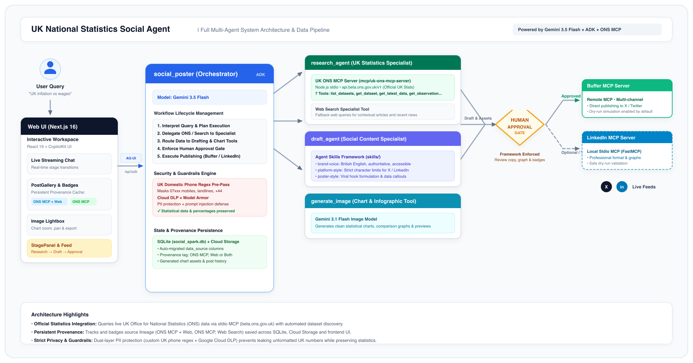

# UK Stat Agent

An AI multi-agent application that answers questions about UK statistics using the official **UK Office for National Statistics (ONS) MCP server**, drafts a post for **X / Twitter** (or LinkedIn) in your brand voice, generates an **easy-to-read statistical graph or chart**, **waits for your approval**, and then publishes through X/Buffer or the local Social MCP server.

> Combines the official UK Office for National Statistics (ONS) MCP server (`mcp/uk-ons-mcp-server`) with Google ADK multi-agent orchestration, custom UK phone privacy guardrails, persistent provenance tracking, and an interactive human approval gate.

---

## How It Works



1. **User Request**: You ask the orchestrator a question about UK statistics (such as inflation/CPIH, regional GDP, youth unemployment, personal wellbeing, card spending, trade, or population demographics).
2. **Specialist Research (`research_agent`)**: Queries official UK datasets from `https://api.beta.ons.gov.uk/v1` over stdio via the **UK ONS MCP Server** (`list_datasets`, `search_datasets`, `get_dataset`, `get_dataset_dimensions`, `get_dimension_options`, `get_observation`, `get_latest_data`) with Google Search fallback for current news context.
3. **Brand-Aligned Drafting (`draft_agent`)**: Formats statistical copy using **Agent Skills** (`brand-voice`, `platform-style`, `poster-style`) adhering to British English conventions and platform character constraints.
4. **Infographic Generation (`generate_image`)**: Generates an accessible, branded statistical chart or graph using Gemini Image models.
5. **Privacy & Guardrails**: Text passes through a **UK Domestic Phone Regex pre-pass** (`07xxx`, landlines, `+44`) and Google Cloud DLP / Model Armor, protecting user PII while preserving statistical figures, dates, and percentages.
6. **Data Provenance**: Every generated post is tagged with its lineage (`🔗 ONS MCP + Web`, `🏛️ ONS MCP`, or `🌐 Web Search`), persisted in SQLite and Cloud Storage, and cached across chat resets.
7. **Human Approval Gate**: Presents the draft, statistical graph, and source badges in the UI. The post is only sent to publishing channels (Buffer or LinkedIn) after you explicitly click **Approve**.

---

## Tech Stack

| Layer | Technology | Role |
|---|---|---|
| **Agent Framework** | [Google ADK](https://google.github.io/adk-docs/) (Python) | Multi-agent orchestrator, sub-agents, tool routing, sessions, evals |
| **UK Statistics MCP** | UK ONS MCP Server (`mcp/uk-ons-mcp-server`) | 7 tools querying live UK Office for National Statistics datasets via Node.js stdio |
| **Foundation Models** | Gemini (`gemini-3.5-flash`, `gemini-3.1-flash-image`) | Statistical reasoning, copy drafting, chart/graph image synthesis |
| **Agent Knowledge** | Agent Skills (`skills/`) | British English voice, platform character limits (X / LinkedIn), data hooks |
| **Publishing** | Buffer MCP (Remote) & LinkedIn MCP (Local stdio FastMCP) | Multi-channel social publishing behind a human approval gate |
| **Backend** | FastAPI + [`ag-ui-adk`](https://github.com/ag-ui-protocol/ag-ui) | Serves the agent over the AG-UI protocol at `/api/adk` |
| **Frontend** | Next.js 16, React 19, [CopilotKit](https://copilotkit.ai) | Streaming chat, StagePanel progress, PostGallery with provenance chips, ImageLightbox |
| **Database & Storage** | SQLite (`social_spark.db`) + Google Cloud Storage | Post persistence, schema auto-migration, hosted image charts |
| **Security & Safety** | UK Phone Regex pre-pass, Cloud DLP, Model Armor | Domestic mobile/landline redaction, prompt injection defense |
| **Tooling** | `uv`, Node.js, `agents-cli`, `pytest` | Dependency management, evaluation, automated testing |

---

## Key Features

- **🏛️ Live UK ONS Data Integration**: Direct access to official UK Government economic and social datasets through an integrated Model Context Protocol (MCP) server.
- **🏷️ Persistent Provenance Badging**: Clear source attribution (`🔗 ONS MCP + Web`, `🏛️ ONS MCP`, `🌐 Web Search`) displayed on every post and preserved in SQLite and local browser storage across chat sessions.
- **🛡️ Custom UK Domestic Phone PII Shield**: Protects UK phone numbers formatted as `07777111222`, `07xxx xxx xxx`, `(020) xxxx xxxx`, or `+44 7xxx` while preventing false-positive redaction of data percentages, years, or currency.
- **📊 Statistical Graph Lightbox**: Click any generated chart in the gallery or chat to open an interactive modal with zoom, pan, and direct image download.
- **🚦 Enforced Human-in-the-Loop Review**: No post is ever published automatically; you review copy, hashtags, data sources, and visual assets before confirming.

---

## Getting Started

### Prerequisites

- [uv](https://docs.astral.sh/uv/) (Python package and environment manager)
- [Node.js](https://nodejs.org/) (v20 or higher)
- A Google Cloud project with Vertex AI enabled (or a Gemini API key)

### 1. Clone & Configure

```bash
cd stat-agent

# Copy sample configuration
cp .env.example backend/social_poster/.env
```

Open `backend/social_poster/.env` and configure your Google Cloud project and credentials:
```bash
GOOGLE_CLOUD_PROJECT=your-gcp-project-id
GOOGLE_GENAI_USE_VERTEXAI=true
DRY_RUN=true
```

### 2. Install Dependencies

```bash
# Python dependencies
uv sync

# Frontend dependencies
cd frontend && npm install && cd ..

# MCP Server dependencies & build
cd mcp/uk-ons-mcp-server && npm install && npm run build && cd ../..
```

### 3. Run Locally

Start the backend and frontend in separate terminals:

```bash
# Terminal 1: Backend API (http://localhost:8000)
./run-backend.sh

# Terminal 2: Frontend Web UI (http://localhost:3000)
./run-frontend.sh
```

> [!NOTE]
> `DRY_RUN=true` is enabled by default so no posts are sent to real social media accounts during development.

---

## Running Tests

Run the automated test suite covering DB migrations, guardrails, and agent routing:

```bash
uv run pytest tests/
```

---

## Repository Structure

```
backend/
├── main.py                     # FastAPI application serving AG-UI protocol
└── social_poster/              # Core agent package
    ├── agent.py                # Multi-agent orchestrator & stage workflow
    ├── db.py                   # SQLite storage, schema migrations & GCS sync
    ├── guardrails.py           # UK Phone Regex pre-pass & Cloud DLP integration
    └── tools.py                # Image generation & Buffer publishing tools
frontend/
├── app/page.tsx                # Next.js main workspace interface
└── app/components/
    ├── PostGallery.tsx         # Approved posts gallery with provenance badges
    ├── StagePanel.tsx          # Real-time workflow progress tracker
    └── ImageLightbox.tsx       # Chart viewer with zoom, pan and download
mcp/
├── uk-ons-mcp-server/          # Official UK ONS MCP Server (Node.js stdio)
└── linkedin_server.py          # FastMCP LinkedIn publishing server
skills/
├── brand-voice/SKILL.md        # British English tone and style guidelines
├── platform-style/SKILL.md     # Platform-specific formatting rules (X, LinkedIn)
└── poster-style/SKILL.md       # High-engagement hook and data formatting rules
docs/                           # Architecture guides and reference documentation
tests/                          # Pytest test suite (DB, guardrails, tools)
```

---

## Deployment & Production References

| Document | Description |
|---|---|
| [agent-runtime-deploy.md](docs/agent-runtime-deploy.md) | Deploying backend to Agent Runtime with managed sessions and Cloud Run frontend |
| [cloud-run-deploy.md](docs/cloud-run-deploy.md) | Containerised deployment via Dockerfile, `cloudbuild.yaml`, IAM, and CI/CD |
| [model-armor-setup.md](docs/model-armor-setup.md) | Setting up Model Armor safety templates and prompt injection defense |
| [observability.md](docs/observability.md) | Tracing via Cloud Trace and BigQuery Agent Analytics |
| [LEARNINGS.md](docs/LEARNINGS.md) | Architectural decisions, guardrail implementation, and performance notes |
