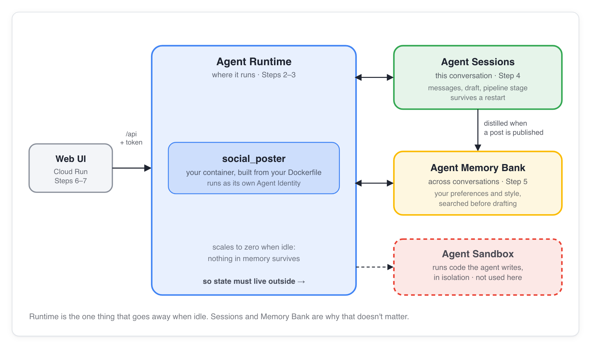

# UK Stat Agent

An AI multi-agent application that answers questions about UK statistics using the official **UK Office for National Statistics (ONS) MCP server**, drafts a post for **X / Twitter** (or LinkedIn) in your brand voice, generates an **easy-to-read statistical graph or chart**, **waits for your approval**, and then publishes through X/Buffer or the local Social MCP server.

> **Start here:** [Setup guide](docs/setup-guide.html) (do this before Saturday) → [Lab 1: Build](docs/lab-1-build.html). All docs are listed in [docs/index.html](docs/index.html).
>
> This repo combines the UK ONS MCP server (`mcp/uk-ons-mcp-server`) with the ADK multi-agent social publishing architecture.

## How it works


You ask the **orchestrator** (`social_poster`) a question about UK statistics (such as inflation/CPIH, regional GDP, personal wellbeing, card spending, trade, or population). It delegates to the **UK ONS research specialist** (`research_agent`), which queries live datasets from `https://api.beta.ons.gov.uk/v1` over stdio via the **UK ONS MCP server** (`list_datasets`, `search_datasets`, `get_dataset`, `get_dataset_dimensions`, `get_dimension_options`, `get_observation`, `get_latest_data`). It then routes the statistical data to the **drafting specialist** (`draft_agent`), which loads **Agent Skills** for X/Twitter formatting and statistical graph styling, generates a clean visual chart/graph via `generate_image`, and presents the answer, draft, and graph for your approval before publishing.

## Tech stack

| Layer | What we use | Why |
|---|---|---|
| Agent framework | [Google ADK](https://google.github.io/adk-docs/) (Python) | Multi-agent orchestrator, specialist sub-agents, tools, sessions, evals |
| UK Statistics MCP | UK ONS MCP Server (`mcp/uk-ons-mcp-server`, Node.js stdio) | 7 read-only tools querying live UK Office for National Statistics datasets |
| Models | Gemini (`gemini-2.5-flash`, `gemini-3.1-flash-image`) | Statistical reasoning, X/Twitter drafting, graph & chart image generation |
| Agent knowledge | Agent Skills (`skills/`) | X/LinkedIn rules, statistical graph style, and British-English brand voice |
| Publishing | MCP servers: Buffer (remote X/Twitter & multi-channel), Social/LinkedIn (local stdio) | Real or dry-run posts behind a framework-enforced human approval gate |
| Agent-to-agent | A2A (`memory_agent`, optional) | A separate memory service the orchestrator can ask |
| Backend | FastAPI + [`ag-ui-adk`](https://github.com/ag-ui-protocol/ag-ui) | Serves the agent to the UI over AG-UI at `/api/adk` |
| Frontend | Next.js 16, React 19, [CopilotKit](https://copilotkit.ai) | Chat, draft preview and the approve button |
| Data | SQLite (local), Cloud Storage (optional images) | Post history and hosted images |
| Cloud | Google Cloud: Agent Runtime, Cloud Run, Cloud Build, Secret Manager | Lab 2 deploy and CI/CD |
| Governance | Model Armor, Cloud DLP, Agent Gateway, Agent Registry | Lab 3 |
| Tooling | `uv`, `agents-cli`, `adk eval`, `gcloud` | Install, deploy, quality gate |

## What you build, lab by lab

| Session | Lab | You add | Tag to check out if you fall behind |
|---|---|---|---|
| Setup | [Setup guide](docs/setup-guide.html) | Google Cloud project, tools, coding agent | `starter` |
| 1. Build | [Lab 1](docs/lab-1-build.html) | The agent, skills, tools, approval gate, web UI | `pillar-build` |
| 2. Scale | [Lab 2](docs/lab-2-scale.html) | Deploy to Agent Runtime, managed sessions and Memory Bank | `pillar-scale` |
| 3. Govern | [Lab 3](docs/lab-3-govern.html) | Model Armor, Cloud DLP, gateway, registry, guardrail evals | `pillar-govern` |

```bash
git checkout pillar-build   # for example: the finished result of Lab 1
```



## Run it locally

You need [uv](https://docs.astral.sh/uv/), Node.js 20+, and a Google Cloud project (see the [setup guide](docs/setup-guide.html)). From the repo root:

```bash
cp .env.example backend/social_poster/.env   # set GOOGLE_CLOUD_PROJECT
uv sync
./run-backend.sh                             # terminal 1: http://localhost:8000
./run-frontend.sh                            # terminal 2: http://localhost:3000
```

Publishing is a dry run (`DRY_RUN=true`) until you switch it off, so nothing goes to a real account by accident. More detail: [backend/README.md](backend/README.md) and [frontend/README.md](frontend/README.md).

## What's where

```
backend/social_poster/   the agents, tools and guardrails (agent.py is the place to start)
backend/main.py          FastAPI app: AG-UI route, sessions and memory when deployed
skills/                  Agent Skills (brand voice)
frontend/                Next.js + CopilotKit UI
evals/                   adk eval sets (quality and governance)
docs/                    labs, setup guide, deploy and reference docs
gcp-setup.sh             one-time Google Cloud setup: APIs, templates, grants
```

## Deploy and reference docs

| Doc | Covers |
|---|---|
| [agent-runtime-deploy.md](docs/agent-runtime-deploy.md) | Deploy to Agent Runtime, sessions and memory, the frontend on Cloud Run |
| [cloud-run-deploy.md](docs/cloud-run-deploy.md) | Optional reference (not used in the labs): Dockerfile, `cloudbuild.yaml`, IAM, eval-gated CI/CD |
| [model-armor-setup.md](docs/model-armor-setup.md) | Guardrail templates, grants and switches |
| [observability.md](docs/observability.md) | Cloud Trace and the BigQuery analytics agent |
| [LEARNINGS.md](docs/LEARNINGS.md) | What broke and why, by pillar |

**What's deployed right now?** An Agent Runtime engine scales to zero when idle, and the console only shows one region at a time, so a deployed agent can look missing. Ask the CLI:

```bash
agents-cli deploy --list --project YOUR_PROJECT --no-confirm-project
```

Target and region come from `agents-cli-manifest.yaml` at the repo root.
